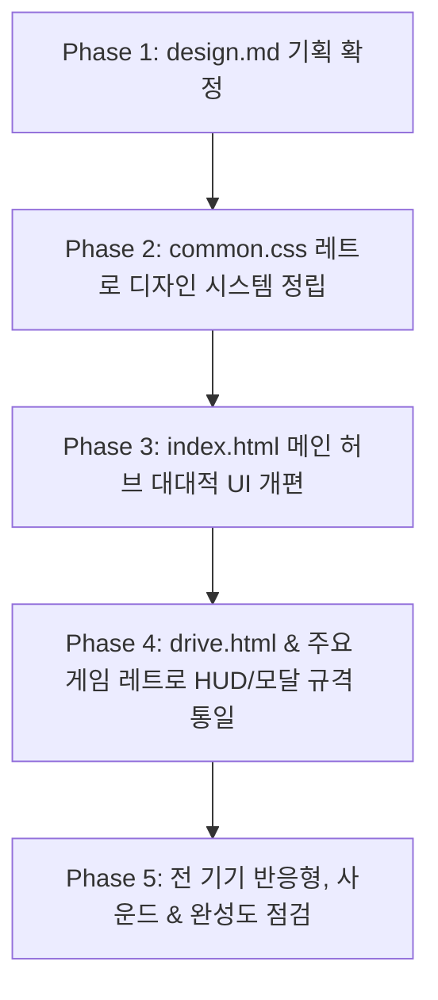

# 🕹️ Woo.Fun 레트로 아케이드 & 추억의 플래시 포털 UI 전면 개편 계획서 (`design.md`)

## 1. 개편 배경 및 문제 진단

### 1.1. 현행 UI의 한계와 위화감
- **과도한 사이버틱/SF 지향성**: 현재 적용된 차가운 네온 시안(`#00f3ff`), 글래스모피즘, 밋밋한 다크 테크 스타일은 현대 SaaS 대시보드나 암호화폐 플랫폼에 가까움.
- **사이트 정체성과의 괴리**: 본 사이트는 '똥피하기(`poo.html`)', '벽돌깨기(`brick.html`)', '스네이크(`snake.html`)', '공룡게임(`dinogame.html`)', '2D 레이싱(`drive.html`)' 등 **2000년대 초중반 플래시 게임 및 오락실 아케이드** 중심의 캐주얼 게임 플랫폼임.
- **방문자의 기대 감성 부재**: 방문자가 기대하는 것은 "어릴 적 야후 꾸러기, 쥬니어네이버, 한게임 플래시, 오락실 문방구 게임기"의 정겹고 통통 튀는 레트로 감성이지만, 현재의 차가운 미래지향적 UI는 진입 장벽과 이질감을 형성함.

### 1.2. 개편 목표 및 지향점 (Benchmark: `drive.html` 감성 확장)
- 최근 구현된 [drive.html](file:///c:/Users/Voltron/Desktop/VScode/new%20folder/drive.html)의 **레트로 2D 아케이드 엔진 감성**을 웹사이트 전체 디자인 시스템으로 확장.
- 과도한 네온/사이버펑크 요소를 걷어내고, **"1990~2000년대 오락실 캐비닛 + 플래시 게임 포털 황금기"**의 독보적인 레트로 토이/아케이드 룩앤필 구축.
- 외관은 향수 어린 레트로이되, **100dvh 모바일 반응형 / 터치 제어 / 웹 접근성**은 최첨단 모던 웹 표준을 유지.

---

## 2. 디자인 아이덴티티 & 콘셉트 키워드

```
+--------------------------------------------------------------------------+
|                     WOO.FUN RETRO PORTAL CONCEPT                         |
+--------------------------------------------------------------------------+
|  [아케이드 캐비닛]    [플래시 감성]    [픽셀 & 볼드]    [택타일 3D 버튼]   |
|  오락실 간판(Marquee)  2000년대 포털   둥근모/도트 폰트   누르는 맛이 있는 |
|  CRT 볼록 테두리       친근하고 활기참  점수판 전광판     엠보스/베벨 버튼 |
+--------------------------------------------------------------------------+
```

| 키워드 | 세부 설명 |
| :--- | :--- |
| **🕹️ Arcade Cabinet** | 오락실 기계 전면부 특유의 플라스틱/메탈 베젤, 동전 투입구(`INSERT COIN`), 상단 간판 조명 |
| **⚡ Nostalgic Flash** | 2000년대 주니어네이버/플래시365 느낌의 귀엽고 아기자기한 색감과 배지, 친근한 위트 |
| **📺 CRT & Pixel Vibes** | 은은한 레트로 모니터 프레임, 픽셀 폰트 포인트, 도트 그래픽 캐릭터와의 조화 |
| **🧱 Tactile 3D Buttons** | 납작한 플랫 버튼 대신 두툼한 그림자와 하이라이트가 살아있는 오락실 푸시 버튼(Push Button) |

---

## 3. 컬러 시스템 & 타이포그래피 사양

### 3.1. 컬러 팔레트 전환
차가운 딥 블루/시안 일색에서 **온기 있는 레트로 아케이드 톤**으로 전환합니다.

```
[ 기존: 차가운 사이버 톤 ]             [ 개편: 레트로 아케이드 톤 ]
#070a14 (차가운 다크 블랙)    ➡️     #1e1b2e / #15141e (아케이드 콘솔 다크 웜)
#00f3ff (차가운 네온 시안)    ➡️     #00cec9 / #0fb9b1 (레트로 토이 민트)
단조로운 블루 박스            ➡️     #f39c12 / #f1c40f (오락실 코인 골드)
#ff0077 (차갑고 쨍한 마젠타)   ➡️     #e74c3c / #d63031 (아케이드 조이스틱 레드)
                             ➡️     #2ecc71 (클래식 1UP 그린)
                             ➡️     #ffeaa7 / #fdcb6e (빈티지 크림 옐로우)
```

- **Background Palette**:
  - Main Dark: `#15141e` (깊은 오락실 배경색)
  - Surface Soft: `#222133` (캐비닛 기기 본체 플라스틱)
  - Panel Surface: `#2a2840` (스탠드/카드 표면)
- **Retro Accent Palette**:
  - `Coin Gold`: `#f1c40f` (헤더 포인트, 하이라이트, 랭킹)
  - `Arcade Red`: `#e74c3c` (도전/시작 버튼, 1UP 표기)
  - `Pixel Green`: `#2ecc71` (성공, 플레이 가능, 니트로)
  - `Retro Cyan`: `#00d2d3` (링크, 보조 HUD)
  - `Console Cream`: `#f8f9fa` (가독성 본문 텍스트)

### 3.2. 타이포그래피 (Typography)
- **타이틀 / 점수 / HUD**: 
  - 픽셀/비트맵 스타일 폰트: `'DungGeunMo'`, `'Press Start 2P'`, `'Courier New'`, `monospace`
  - 8비트/16비트 오락실 전광판 느낌의 자간과 텍스트 그림자(입체감)
- **본문 / 설명 / 조작 가이드**:
  - 맑은 가독성을 갖추되 둥글고 귀여운 폰트 스택: `'Galmuri9'`, `'Pretendard'`, `'Apple SD Gothic Neo'`, `'Segoe UI'`
- **텍스트 이펙트**:
  - 밋밋한 텍스트 대신 `text-shadow: 2px 2px 0px #000` 형태의 클래식 게임 외곽선 스타일 적용

---

## 4. 메인 허브 ([index.html](file:///c:/Users/Voltron/Desktop/VScode/new%20folder/index.html)) UI 개편안

### 4.1. 상단 마퀴(Marquee) & 오락실 간판 헤더
- **네온 전광판 스타일 타이틀**:
  - "🕹️ WOO.FUN FLASH ARCADE"
  - 반짝이는 점멸 효과(`blink` 애니메이션): `INSERT COIN`, `1P READY!`
  - 클래식 카운터 HUD: 등록된 게임 수, 플레이 모드, 오락실 코인 잔여(`CREDIT 99`)
- **레트로 컨트롤 바**:
  - 오락실 토글 스위치 형태의 카테고리 필터 (전체, 아케이드, 스피드/액션, 퍼즐, 클래식)
  - BGM 사운드 토글 / CRT 스캔라인 필터 On/Off 토글

### 4.2. 아케이드 게임 카드 (Game Cartridge & Cabinet Card)
- 기존의 평범한 평면 사각형 카드를 **"레트로 게임 팩(Cartridge) & 미니 오락기 캐비닛"** 모티프로 탈바꿈:
  - **상단 베젤**: 게임 아이콘 + 픽셀 도트 타이틀 + 레트로 태그 (`[HOT]`, `[FLASH 2000s]`, `[ARCADE]`)
  - **스크린 윈도우**: 마치 작은 브라운관 모니터 화면을 들여다보는 듯한 둥근 모서리와 도트 프레임 (마우스 호버 시 가벼운 스캔라인 펄스)
  - **하단 컨트롤 패드**:
    - 누르면 딸깍하고 3px 내려앉는 묵직한 3D 아케이드 푸시 버튼 (`▶ GAME START`)
    - 조작법(키보드/모바일 터치)을 픽셀 아이콘(`[WASD]`, `[TOUCH]`)으로 직관적 표시
    - "기록 갱신 / 최고 점수" 뱃지

### 4.3. 레트로 보너스 위젯
- **오락실 랭킹 전광판 (Hall of Fame)**: 각 게임별 베스트 스코어 티커
- **랜덤 게임 룰렛 (INSERT COIN)**: 동전을 넣으면 오늘 할 게임을 오락실 뽑기 기계처럼 무작위 추천

---

## 5. 개별 게임 연계 및 일관성 확보 ([drive.html](file:///c:/Users/Voltron/Desktop/VScode/new%20folder/drive.html) 등)

| 게임 | 현재 상태 | 레트로 UI 개편 적용 방향 |
| :--- | :--- | :--- |
| **🏎️ Steel Racer (`drive.html`)** | 고성능 2D 레이싱 완성 | 상단 HUD를 오락실 전광판 스타일로 완성, 헤더 색상 톤을 사이버틱 네온에서 클래식 아케이드 톤으로 소폭 정돈 |
| **💩 똥피하기 (`poo.html`)** | 2000년대 감성 캐릭터 보유 | 옛날 쥬니어네이버/짱게임 스타일 스킨 적용, 3D 푸시 버튼 및 오락실 점수판 탑재 |
| **🧱 벽돌깨기 (`brick.html`)** | 클래식 아케이드 | 알카노이드(Arkanoid) 오락실 캐비닛 스킨, 패들/볼 레트로 컬러링 |
| **🐍 스네이크 (`snake.html`)** | 노키아/레트로 픽셀 | 2000년대 그린 LCD 게임보이 테마 또는 픽셀 아케이드 테마 선택 기능 |
| **🦖 공룡게임 (`dinogame.html`)** | 클래식 러닝 | 레트로 브라운관 모니터 베젤 및 오락실 하이스코어 사운드 연동 |

---

## 6. [common.css](file:///c:/Users/Voltron/Desktop/VScode/new%20folder/common.css) 리팩토링 및 레트로 컴포넌트 규격

통일된 디자인을 위해 `common.css`에 아래 공용 레트로 클래스 체계를 정립합니다.

### 6.1. 3D 아케이드 푸시 버튼 (`.btn-arcade-3d`)
```css
.btn-arcade-3d {
  background: #e74c3c;
  color: #ffffff;
  border: none;
  border-radius: 8px;
  padding: 10px 20px;
  font-family: var(--font-arcade);
  font-weight: 800;
  text-transform: uppercase;
  letter-spacing: 1px;
  box-shadow: 0 6px 0 #c0392b, 0 10px 15px rgba(0,0,0,0.4);
  cursor: pointer;
  transition: all 0.08s ease;
}
.btn-arcade-3d:active {
  transform: translateY(4px);
  box-shadow: 0 2px 0 #c0392b, 0 4px 6px rgba(0,0,0,0.4);
}
```

### 6.2. 레트로 브라운관 모니터 프레임 (`.crt-panel`)
```css
.crt-panel {
  background: #11131a;
  border: 4px solid #34374c;
  border-radius: 12px;
  box-shadow: inset 0 0 18px rgba(0,0,0,0.8), 0 8px 24px rgba(0,0,0,0.5);
  position: relative;
  overflow: hidden;
}
```

### 6.3. 레트로 오락실 헤더 (`.arcade-header`)
- 모든 게임 상단에 공통으로 들어가는 통일 규격:
  - `[홈으로 / 🏠 ARCADE HUB]` (좌측 버튼)
  - `[게임 로고 & 타이틀]` (중앙 레트로 간판)
  - `[1UP / HIGH SCORE / PAUSE]` (우측 전광판 HUD)

---

## 7. 단계별 실행 계획 (Roadmap)



1. **Phase 1 (완료)**: `design.md` 기획서 작성 및 레트로 아케이드 컨셉 정의
2. **Phase 2**: [common.css](file:///c:/Users/Voltron/Desktop/VScode/new%20folder/common.css) 디자인 토큰 및 레트로 아케이드 컴포넌트(3D 버튼, CRT 패널, 스코어보드, 픽셀 보더) 전면 구축
3. **Phase 3**: [index.html](file:///c:/Users/Voltron/Desktop/VScode/new%20folder/index.html) 메인 허브 개편 (오락실 마퀴 헤더, 게임 팩/캐비닛 카드, 2000년대 플래시 감성 인터랙션)
4. **Phase 4**: [drive.html](file:///c:/Users/Voltron/Desktop/VScode/new%20folder/drive.html)과 [poo.html](file:///c:/Users/Voltron/Desktop/VScode/new%20folder/poo.html), [brick.html](file:///c:/Users/Voltron/Desktop/VScode/new%20folder/brick.html)의 헤더 및 모달 UI를 공통 레트로 규격에 완벽 일치화
5. **Phase 5**: 모바일(100dvh 가상 패드 터치), 데스크톱 키보드 조작감 및 시각적 만족도 최종 검증

---

## 8. UI 전면 개편 시 발생 가능한 잠재적 장애 및 전방위 대응 수칙 (Failure Defense Protocols)

UI 구조와 스타일을 근본적으로 뜯어고칠 때 일어날 수 있는 **7대 핵심 장애 시나리오(Critical Failure Modes)**와 **절대 준수 대응 수칙**을 명문화합니다.

```
+-----------------------------------------------------------------------------------+
|                        7대 UI 개편 잠재 결함 & 방어 체계                         |
+-----------------------------------------------------------------------------------+
| 1. JS 바인딩 파괴        ➡️ [ID & data-* 불변 원칙] (스타일 클래스만 변경)        |
| 2. 캔버스 영역 침범/왜곡 ➡️ [격리 레이어 & 종횡비 고정 래퍼 보호]                 |
| 3. 모바일 터치 고착/누락  ➡️ [터치 타깃 분리 & Pointer 이벤트 4종 바인딩]          |
| 4. CSS 전역 오염/누수    ➡️ [하위 호환 변수 Fallback & 네임스페이스 격리]         |
| 5. 폰트 지연 및 레이아웃 ➡️ [document.fonts.ready & 시스템 모노스페이스 Fallback] |
| 6. CRT/그림자 렌더링 렉  ➡️ [GPU 가속 제한적 활용 & 스캔라인 On/Off 스위치]        |
| 7. 로컬스토리지 기록 유실 ➡️ [스토리지 키 영속성 보장 & 마이그레이션 방어 코드]    |
+-----------------------------------------------------------------------------------+
```

---

### [장애 1] DOM 구조/클래스 변경에 따른 기존 JS 이벤트 바인딩 파괴 (Selector Breakage)
- **위험 증상**: 
  - 모달 열기/닫기, 게임 시작(`Start`), 재시작(`Retry`), 정지(`Pause`), 음소거 버튼 클릭 시 반응 없음.
  - 콘솔에 `TypeError: Cannot read properties of null (reading 'addEventListener')` 발생하며 게임 루프 자체 중단.
- **발생 원인**:
  - CSS 리뉴얼 과정에서 버튼 태그의 `id`, `class`명을 임의로 바꾸거나 부모-자식 계층 트리를 변경하여 JS의 `document.getElementById()`, `querySelector()`가 요소를 찾지 못함.
- **🛡️ 대응 수칙**:
  1. **식별자 분리 원칙**: UI 스타일 변경에는 전용 클래스(`.btn-arcade-3d` 등)만 사용하고, JS 이벤트 바인딩용 `id` 및 `data-*` 속성은 **단 1글자도 변경 금지**.
  2. **Null-Safety 가드 필수화**:
     ```javascript
     // 취약한 코드: const btn = document.getElementById('start-btn'); btn.addEventListener(...);
     // 방어 코드:
     const btn = document.getElementById('start-btn');
     if (btn) {
       btn.addEventListener('click', handleStart);
     } else {
       console.warn('[UI Warning] #start-btn 요소를 찾을 수 없습니다.');
     }
     ```
  3. **DOM 교체 전 전수 검사**: 파일 내 모든 `getElementById`, `querySelector`, `addEventListener` 목록을 사전에 추출하여 체크리스트화한 후 작업.

---

### [장애 2] 게임 캔버스(Canvas) 뷰포트 잘림 및 해상도/종횡비 왜곡 (Canvas Distortion)
- **위험 증상**:
  - 새로 추가된 오락실 헤더 바나 두꺼운 레트로 테두리 때문에 게임 캔버스 하단이나 조작부가 잘려서 가려짐.
  - 브라우저 크기 조절 시 캔버스 비율이 찌그러지거나 마우스/터치 좌표와 실제 게임 오브젝트 위치 간의 불일치 발생.
- **발생 원인**:
  - `drive.html`, `poo.html`, `brick.html` 등은 고유의 가상 해상도(예: 960x540, 800x600)와 종횡비 유지 스케일링 JS 수식을 갖고 있음.
  - 헤더의 `height`, `margin`, `padding`이 늘어나면서 캔버스 유효 렌더링 높이를 침범함.
- **🛡️ 대응 수칙**:
  1. **캔버스 래퍼 영역 절대 보존**: 게임 캔버스를 감싸는 `#canvas-wrapper`의 치수 및 CSS 변환(`transform: scale(...)`) 로직은 수정하지 않음.
  2. **헤더 고정 높이 통일 (`44px` 규격)**: [drive.html](file:///c:/Users/Voltron/Desktop/VScode/new%20folder/drive.html)에서 검증된 콤팩트 헤더 높이(`44px`)를 모든 게임에 일괄 적용하여 캔버스 침범을 0%로 통제.
  3. **좌표 변환식 동기화**: 마우스/터치 좌표를 캔버스 내부 좌표로 변환하는 `getBoundingClientRect()` 기반 정규화 로직 유지.

---

### [장애 3] 레트로 3D 버튼 효과로 인한 모바일 터치 유실 및 키 고착 (Pointer Input Malfunction)
- **위험 증상**:
  - 누르면 딸깍하고 내려가는 3D 버튼 효과(`transform: translateY(4px)`) 때문에 터치 중 손가락 위치가 버튼 바깥으로 인식되어 입력이 끊기거나, 반대로 손을 뗐는데도 누르고 있는 것으로 인식(키 고착 버그).
  - 버튼을 빠르게 연속 탭할 때 브라우저 돋보기/확대(`pinch zoom`)가 발동되어 게임 멈춤.
- **발생 원인**:
  - CSS 시각적 이동이 터치 이벤트 바운딩 박스를 흔들거나, 터치 기본 동작(`touch-action`)이 비활성화되지 않음.
- **🛡️ 대응 수칙**:
  1. **히트박스(Hitbox)와 비주얼(Visual) 분리**:
     - 실제 터치를 감지하는 영역은 가상 패딩을 포함해 **최소 48x48px 이상 고정**하고, 움직이는 효과는 내부 가상 요소(`::after` 또는 텍스트 span)에만 부여.
  2. **터치 4대 이벤트 완벽 바인딩**:
     - `pointerdown`, `pointerup`, `pointercancel`, `pointerleave` 4개 이벤트를 모두 걸고, 화면 밖으로 손가락이 나가도 전역 `window.pointerup`에서 강제 초기화.
  3. **터치 제스처 방어 CSS 필수 삽입**:
     ```css
     .arcade-btn, .touch-btn {
       touch-action: none;
       -webkit-touch-callout: none;
       user-select: none;
       -webkit-user-select: none;
     }
     ```

---

### [장애 4] `common.css` 수정에 따른 다른 하위 페이지 연쇄 스타일 붕괴 (Style Leakage)
- **위험 증상**:
  - `common.css`의 `:root` 변수나 전역 태그 셀렉터(`body`, `button`, `input`, `h1`)를 수정했더니, 작업 대상이 아니었던 다른 페이지([skills.html](file:///c:/Users/Voltron/Desktop/VScode/new%20folder/skills.html), [graph.html](file:///c:/Users/Voltron/Desktop/VScode/new%20folder/graph.html), [hypnosis.html](file:///c:/Users/Voltron/Desktop/VScode/new%20folder/hypnosis.html) 등)의 레이아웃이 와르르 깨짐.
- **발생 원인**:
  - 전역 스코프 셀렉터의 무차별적 오버라이드 및 기존 CSS 변수 삭제.
- **🛡️ 대응 수칙**:
  1. **CSS 변수 하위 호환성(Fallback) 보장**:
     - 기존 변수(`--bg-dark`, `--gold`, `--teal` 등)를 삭제하지 않고 유지하거나, 기존 변수를 참조하는 곳이 깨지지 않도록 매핑 유지.
  2. **엄격한 BEM/네임스페이스 도입**:
     - 새로운 레트로 컴포넌트는 `.retro-*`, `.arcade-*` 접두사를 붙여 기존 스타일에 영향을 주지 않도록 스코프 격리.
  3. **페이지별 리그레션(회귀) 시각 점검**:
     - `common.css` 수정 직후 `index.html`, `drive.html`, `skills.html`, `poo.html`을 즉시 열어 레이아웃 영향 여부 확인.

---

### [장애 5] 레트로 비트맵 웹폰트 로딩 지연 및 레이아웃 흔들림 (FOUT / Canvas Text Glitch)
- **위험 증상**:
  - 사이트 로드 시 폰트가 늦게 떠서 텍스트 크기가 갑자기 커지며 레이아웃이 덜컥거림(Cumulative Layout Shift).
  - Canvas 게임 내부에서 비트맵 폰트로 점수나 안내 문구를 그리는데, 폰트 다운로드 전 렌더링되어 일반 돋움/굴림체로 영구 고정되어 렌더링되는 현상.
- **발생 원인**:
  - 외부 웹폰트(Google Fonts, CDN) 로딩 시간과 캔버스 최초 프레임 렌더링 간의 비동기 타이밍 미스.
- **🛡️ 대응 수칙**:
  1. **시스템 모노스페이스 Fallback 명시**:
     ```css
     font-family: 'DungGeunMo', 'Press Start 2P', 'Cascadia Code', 'Courier New', monospace;
     ```
  2. **Canvas 폰트 대기(Font Readiness Guard) 로직**:
     ```javascript
     // 캔버스 초기화 시 웹폰트 로드 완료 후 렌더링 시작
     if (document.fonts) {
       document.fonts.ready.then(() => {
         renderGame();
       });
     } else {
       renderGame();
     }
     ```

---

### [장애 6] CRT 스캔라인 및 묵직한 그림자 효과로 인한 모바일 프레임 드랍 (Performance Throttling)
- **위험 증상**:
  - 옛날 느낌을 낸다고 브라운관 CRT 스캔라인 패턴, 과도한 `box-shadow` 다중 중첩, `backdrop-filter: blur(15px)`를 과도하게 걸면 저사양 스마트폰이나 구형 랩탑에서 60fps가 25fps로 곤두박질치며 뚝뚝 끊김.
- **발생 원인**:
  - GPU 픽셀 셰이더 부하 누적. 특히 매 프레임 다시 그려지는 캔버스 상단에 필터 레이어가 얹혀있으면 렌더링 파이프라인 병목 발생.
- **🛡️ 대응 수칙**:
  1. **CRT 효과의 경량화 & 제어권 제공**:
     - 스캔라인은 무거운 SVG 필터 대신 2px CSS `repeating-linear-gradient`로 가볍게 구현하고, `pointer-events: none` 필수 적용.
     - 사용자 환경에 맞추어 헤더에서 **[📺 CRT 효과 ON/OFF 토글]** 버튼 제공.
  2. **캔버스 레이어 하드웨어 가속 보호**:
     - `#gameCanvas`에는 무거운 CSS 필터를 걸지 않고 순수 픽셀 렌더링 유지 (`image-rendering: pixelated`).

---

### [장애 7] 로컬 저장소(LocalStorage) 하이스코어/설정 데이터 유실 (State Loss)
- **위험 증상**:
  - 사용자가 기존에 기록해둔 똥피하기/드라이브 최고 기록, 설정값이 UI 개편 후 0으로 리셋되거나 사라짐.
- **발생 원인**:
  - UI를 고치면서 스토리지 키 이름을 임의로 변경하거나(예: `woofun_drive_hiscore` ➡️ `steel_racer_score`), 데이터 형식을 문자열/객체로 잘못 덮어씀.
- **🛡️ 대응 수칙**:
  1. **스토리지 키 영구 보존 규약**:
     - 기존에 브라우저 로컬스토리지에 저장되던 키(Key) 이름은 절대 변경하지 않음.
  2. **안전한 JSON 파싱 및 기본값 방어**:
     ```javascript
     function getHighScore(key, defaultValue = 0) {
       try {
         const val = localStorage.getItem(key);
         return val !== null && !isNaN(Number(val)) ? Number(val) : defaultValue;
       } catch (e) {
         return defaultValue;
       }
     }
     ```

---

## 9. 롤백(Rollback) 및 단계별 무결성 검증 체크리스트

모든 변경 작업은 단계마다 아래 5개 검증 항목을 통과해야만 다음 단계로 넘어갑니다.

- [ ] **[Check 1] JS 콘솔 에러 제로**: 개발자 도구(F12) 콘솔 창에 붉은색 에러 메시지가 0건인가?
- [ ] **[Check 2] 캔버스 조작 좌표 일치**: 게임 내 클릭/터치 좌표가 캔버스 내부 위치와 100% 일치하는가?
- [ ] **[Check 3] 모바일 가상 조작 정상 작동**: 터치 버튼을 누른 채 화면 밖으로 손가락을 떼어도 키가 계속 눌려있지 않은가?
- [ ] **[Check 4] 하위 호환성 유지**: [skills.html](file:///c:/Users/Voltron/Desktop/VScode/new%20folder/skills.html) 등 다른 서브 페이지가 깨지지 않고 정상 출력되는가?
- [ ] **[Check 5] 60FPS 성능 유지**: 모바일/데스크톱 모두에서 뚝뚝 끊김 없이 부드럽게 돌아가는가?

---

## 10. 전역 HTML 표준 가이드라인 & 시맨틱 마크업 규격 (HTML Standard Guidelines)

UI 전면 개편 시 일관성 있는 코드 품질, 브라우저 호환성, 검색엔진 최적화(SEO), 웹 접근성(A11y) 및 유지보수성을 보장하기 위한 **공통 HTML 작성 표준 명세서**입니다. 본 프로젝트의 모든 HTML 파일([index.html](file:///c:/Users/Voltron/Desktop/VScode/new%20folder/index.html), [drive.html](file:///c:/Users/Voltron/Desktop/VScode/new%20folder/drive.html), [poo.html](file:///c:/Users/Voltron/Desktop/VScode/new%20folder/poo.html), [brick.html](file:///c:/Users/Voltron/Desktop/VScode/new%20folder/brick.html), [snake.html](file:///c:/Users/Voltron/Desktop/VScode/new%20folder/snake.html) 등)은 예외 없이 본 규격을 엄수해야 합니다.

```
+-------------------------------------------------------------------------------+
|                       WOO.FUN HTML ARCHITECTURE STANDARD                      |
+-------------------------------------------------------------------------------+
| 1. 문서 기본 뼈대  : HTML5 Doctype, UTF-8, dvh/viewport-fit 대응 메타태그     |
| 2. SEO & 메타데이터: 고유 Title, Description, Open Graph (SNS 공유), Favicon  |
| 3. 시맨틱 랜드마크 : header, nav, main, section, footer & 단일 h1 계층 구조   |
| 4. 접근성 (A11y)   : skip-link, sr-only 텍스트, aria-label, aria-live 실시간  |
| 5. 조작부 규격화   : type="button" 명시, 인라인 이벤트(onclick) 금지, 고유 ID |
| 6. 게임 DOM 컨테이너: 100dvh Viewport -> Fixed Aspect Wrapper -> Canvas 2D   |
| 7. 자산 로딩 최적화: width/height 명시 (CLS 0 방어), loading="lazy", defer     |
+-------------------------------------------------------------------------------+
```

---

### 10.1. 기본 문서 뼈대 및 필수 메타태그 규약 (Document Shell)

모든 HTML 파일은 W3C 유효성을 검증받은 최신 표준 템플릿으로 시작해야 합니다.

```html
<!DOCTYPE html>
<html lang="ko">
<head>
  <!-- 1. 기본 인코딩 & 렌더링 엔진 -->
  <meta charset="UTF-8">
  <meta http-equiv="X-UA-Compatible" content="IE=edge">

  <!-- 2. 반응형 뷰포트 (노치 영역 및 모바일 주소창 대응) -->
  <meta name="viewport" content="width=device-width, initial-scale=1.0, maximum-scale=1.0, user-scalable=no, viewport-fit=cover">

  <!-- 3. 검색엔진 최적화 (SEO) 필수 태그 -->
  <title>🏎️ STEEL RACER: NEON CIRCUIT | Woo.Fun 아케이드</title>
  <meta name="description" content="2000년대 레트로 감성의 2D 탑다운 아케이드 레이싱 게임! 트랙을 질주하고 랩타임 기록을 경신하세요.">
  <meta name="keywords" content="플래시게임, 레트로게임, 아케이드, 레이싱게임, 똥피하기, 벽돌깨기, 웹게임">
  <meta name="author" content="Woo.Fun">
  <meta name="robots" content="index, follow">

  <!-- 4. 소셜 공유 (Open Graph & Twitter Card) -->
  <meta property="og:type" content="website">
  <meta property="og:site_name" content="Woo.Fun Retro Arcade">
  <meta property="og:title" content="🏎️ STEEL RACER: NEON CIRCUIT | Woo.Fun">
  <meta property="og:description" content="추억의 오락실 감성 2D 탑다운 레이싱을 지금 브라우저에서 바로 즐겨보세요!">
  <meta property="og:image" content="https://woofun.games/preview-drive.png">
  <meta property="og:url" content="https://woofun.games/drive.html">
  <meta name="twitter:card" content="summary_large_image">

  <!-- 5. 파비콘 및 공통 스타일 -->
  <link rel="icon" href="data:image/svg+xml,<svg xmlns=%22http://www.w3.org/2000/svg%22 viewBox=%220%22%3E<text y=%2226%22 font-size=%2228%22>🕹️</text></svg>">
  <link rel="stylesheet" href="common.css">
</head>
```

#### 📌 필수 체크 항목
- **`lang="ko"`**: 스크린 리더 음성 엔진이 한국어로 정확히 발음할 수 있도록 문서 루트 언어 선언.
- **`viewport-fit=cover`**: 최신 스마트폰의 노치(Safe Area) 및 다이내믹 아일랜드 영역까지 안전하게 화면을 채울 수 있도록 보장.
- **고유 `<title>` 및 `<meta name="description">`**: 모든 페이지마다 서로 다른 고유하고 구체적인 제목과 설명을 부여하여 검색 포털 노출도 극대화.

---

### 10.2. 시맨틱 랜드마크 및 헤딩(Heading) 계층 구조

단순 `<div>` 나열을 지양하고 HTML5 표준 시맨틱 요소를 배치하여 문서의 구조적 완성도를 확보합니다.

```
<body>
  ├── <a class="skip-link"> (본문 바로가기)
  ├── <header class="arcade-header"> (상단 간판, 로고, 내비게이션)
  │    └── <nav aria-label="메인 내비게이션">
  ├── <main id="main-content"> (페이지 핵심 영역)
  │    ├── <h1> (페이지당 반드시 유일한 1개)
  │    ├── <section id="featured-games">
  │    │    └── <h2> (섹션 주제)
  │    │         └── <article class="game-cartridge"> (개별 게임 카드)
  │    │              └── <h3> (게임 타이틀)
  │    └── <section id="leaderboard">
  │         └── <h2> (랭킹 전광판 주제)
  └── <footer class="arcade-footer"> (저작권, 사이트맵, 피드백)
```

#### 📌 헤딩 계층 규칙 (`h1` ~ `h6`)
- **`<h1>`은 페이지당 단 1개만 사용**: 
  - `index.html`: `<h1>WOO.FUN RETRO FLASH ARCADE</h1>`
  - `drive.html`: `<h1>STEEL RACER: NEON CIRCUIT</h1>`
- **헤딩 단계 건너뛰기 금지**: `<h1>` 바로 다음에 `<h3>`가 오지 않도록 반드시 `<h2>`를 거쳐 `<h3>`로 이어지는 논리적 트리 유지.
- 디자인상 텍스트를 숨겨야 하는 헤딩(예: 리더보드 섹션 제목)은 생략하지 말고 `.sr-only` 클래스로 마크업.

---

### 10.3. 대화형 요소(Interactive Elements) 및 고유 ID 규약

- **모든 버튼은 `<button type="button">` 명시**:
  - `<a>` 태그는 실제 페이지 이동(href 링크)에만 사용하고, 게임 시작/모달 열기/조작 등 액션에는 반드시 `<button>` 태그를 사용.
  - `<form>` 내부가 아니더라도 의도치 않은 서브밋(Submit) 새로고침을 방지하기 위해 `type="button"`을 명시적으로 선언.
  - 의미 없는 `<div onclick="...">` 또는 `<span onclick="...">` 사용을 전면 금지 (키보드 탭 및 엔터키 접근 불가 방지).
- **고유 식별자(ID) 부여 규칙**:
  - 모든 대화형 인터랙티브 요소는 자동화 테스트, 접근성 연결, JS 바인딩을 위해 **유일하고 설명적인 kebab-case ID**를 필수 보유.
  - 예시:
    - `id="btn-game-start"`
    - `id="btn-pause-toggle"`
    - `id="btn-sound-mute"`
    - `id="btn-touch-left"`
    - `id="modal-gameover-card"`
- **인라인 이벤트 핸들러(`onclick`, `onkeydown` 등) 절대 금지**:
  - HTML 내부에 `onclick="startGame()"`과 같은 인라인 스크립트를 삽입하지 않음.
  - 구조(HTML)와 로직(JS)을 철저히 분리하여 `script` 파일에서 `addEventListener`로만 결합.

---

### 10.4. 웹 접근성 (Accessibility - A11y) 표준 규격

시각 장애인, 키보드 사용자, 모바일 음성 보조 기술 사용자를 위한 필수 마크업 규정입니다.

#### 1) 본문 바로가기 링크 (`skip-link`) 필수 삽입
모든 페이지 `<body>` 태그 최상단에 스킵 내비게이션을 배치하여 탭 키 사용자가 반복되는 헤더를 건너뛸 수 있도록 지원.
```html
<a href="#main-content" class="skip-link">본문 바로가기</a>
```

#### 2) 스크린 리더 보조 텍스트 (`.sr-only`)
아이콘만 있는 버튼(예: 🔊, ⚙️, ✕)은 시각장애인에게 의미가 전달되지 않으므로 반드시 숨김 설명 텍스트를 포함.
```html
<button type="button" id="btn-sound-toggle" class="btn-icon" aria-pressed="false">
  <span class="icon-emoji" aria-hidden="true">🔊</span>
  <span class="sr-only">배경 음악 켜기/끄기</span>
</button>
```

#### 3) 실시간 상태 변경 알림 (`aria-live`)
게임 내 점수 변경, 남은 시간, 토스트 알림은 화면을 보지 않고도 인지할 수 있도록 `aria-live` 속성을 부여.
```html
<div id="hud-toast" role="status" aria-live="polite" class="toast-banner"></div>
<div id="hud-score" aria-live="off" class="score-display">00000</div>
```

#### 4) 모달 및 팝업 대화상자 마크업
게임 일시정지, 게임오버, 트랙 선택 창 등 오버레이 모달은 `role="dialog"`와 `aria-modal="true"`, `aria-labelledby`를 필수로 지정.
```html
<div id="modal-gameover" role="dialog" aria-modal="true" aria-labelledby="gameover-title" class="overlay-modal">
  <div class="modal-card">
    <h2 id="gameover-title">GAME OVER</h2>
    <p id="gameover-desc">최종 기록을 확인하세요!</p>
    <button type="button" id="btn-retry" class="btn-arcade-3d">RETRY</button>
  </div>
</div>
```

---

### 10.5. 게임 전용 캔버스 & 가상 컨트롤러 DOM 표준 구조

게임 페이지([drive.html](file:///c:/Users/Voltron/Desktop/VScode/new%20folder/drive.html), [poo.html](file:///c:/Users/Voltron/Desktop/VScode/new%20folder/poo.html), [brick.html](file:///c:/Users/Voltron/Desktop/VScode/new%20folder/brick.html) 등)는 반응형 뷰포트와 캔버스 스케일링 무결성을 위해 다음 3단계 컨테이너 계층 구조를 의무화합니다.

```html
<!-- [1단계] 뷰포트 컨테이너: 100dvh 전체 화면 장악 및 레터박스/필러박스 배경 -->
<div id="viewport-container">

  <!-- [상단 헤더 바] 44px 고정 높이 HUD & 뒤로가기 -->
  <header class="header-bar" role="banner">
    <div class="header-left">
      <a href="index.html" class="btn-nav" id="btn-back-hub">
        <span aria-hidden="true">◀</span> <span>HUB</span>
      </a>
      <div class="hud-pill" id="hud-lap-box">
        <span class="hud-label">LAP</span>
        <span class="hud-val" id="hud-lap">1/3</span>
      </div>
    </div>
    <!-- 속도계 및 액션 버튼 생략 -->
  </header>

  <!-- [2단계] 가상 해상도 래퍼: 고정 종횡비 캔버스 스케일링 영역 -->
  <div id="canvas-wrapper">
    <canvas id="gameCanvas" width="960" height="540" aria-label="Steel Racer 게임 화면">
      웹 브라우저가 HTML5 Canvas 요소를 지원하지 않습니다. 최신 브라우저로 접속해 주세요.
    </canvas>
  </div>

  <!-- [3단계] 모바일 터치 오버레이: 캔버스를 침범하지 않는 독립 포인터 레이어 -->
  <div id="mobile-controls" aria-label="모바일 터치 컨트롤러">
    <button type="button" id="btn-touch-left" class="touch-btn" aria-label="좌회전">◀</button>
    <button type="button" id="btn-touch-right" class="touch-btn" aria-label="우회전">▶</button>
    <button type="button" id="btn-touch-gas" class="touch-btn" aria-label="가속">▲</button>
    <button type="button" id="btn-touch-brake" class="touch-btn" aria-label="브레이크">▼</button>
  </div>

</div>
```

---

### 10.6. 미디어 자산 및 리소스 최적화 규격

- **이미지 태그(``) 4대 필수 속성**:
  1. `alt="..."`: 이미지 의미를 담은 대체 텍스트 (단순 장식용 아이콘일 경우 `alt="" aria-hidden="true"`)
  2. `width="..."`, `height="..."`: 고유 크기를 숫자로 명시하여 브라우저 렌더링 시 레이아웃 흔들림(CLS: Cumulative Layout Shift) 원천 방지
  3. `loading="lazy"`: 화면 스크롤 바깥(Below-the-fold)의 게임 썸네일에 적용하여 초기 로딩 속도 향상
  4. `decoding="async"`: 이미지 디코딩을 백그라운드로 처리하여 메인 스레드 렌더링 지연 제거
  ```html
  
  ```
- **스크립트 로딩**:
  - 외부 스크립트는 `<script defer src="...">` 또는 `type="module"`을 사용하여 HTML 파싱을 차단하지 않도록 최적화.

---

### 10.7. 코드 스타일 및 포맷팅 컨벤션

| 항목 | 표준 사양 | 금지 사항 |
| :--- | :--- | :--- |
| **들여쓰기** | 2개의 공백(Spaces)으로 통일 | 탭(Tab) 사용 금지 |
| **태그/속성 대소문자** | 전부 소문자 (`<div class="box">`) | 대문자 혼용 (`<DIV CLASS="box">`) 금지 |
| **따옴표** | 속성값에 쌍따옴표(`"`) 통일 | 따옴표 누락 또는 홑따옴표 혼용 지양 |
| **닫는 태그** | 모든 요소의 종료 태그 명시 | 태그 누락 방지 |
| **주석 규격** | 섹션 시작과 끝을 주석 박스로 명확히 표기 | 불명확한 단발성 메모 지양 |

